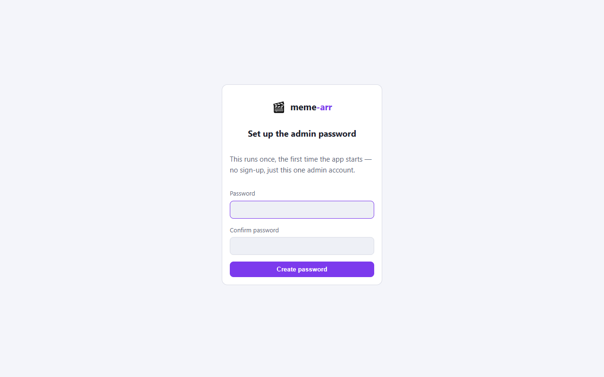
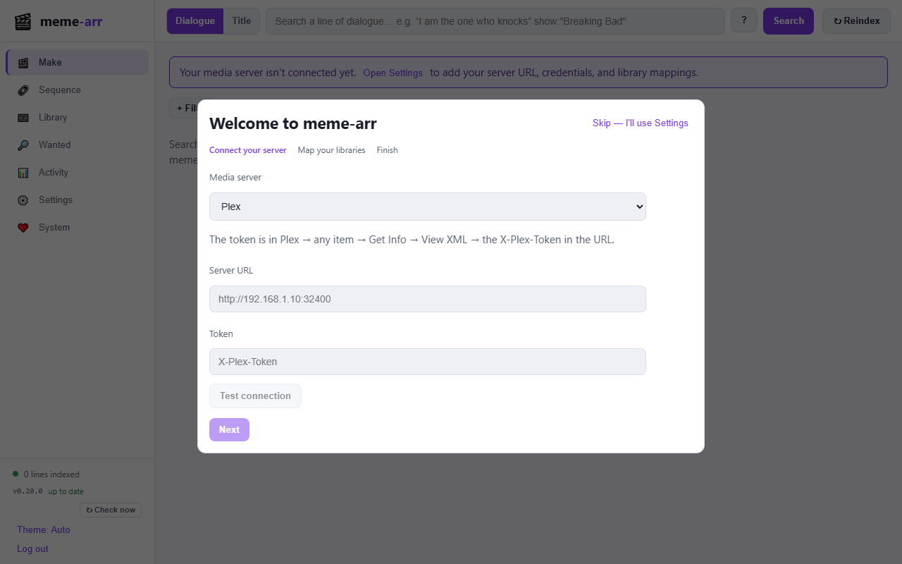
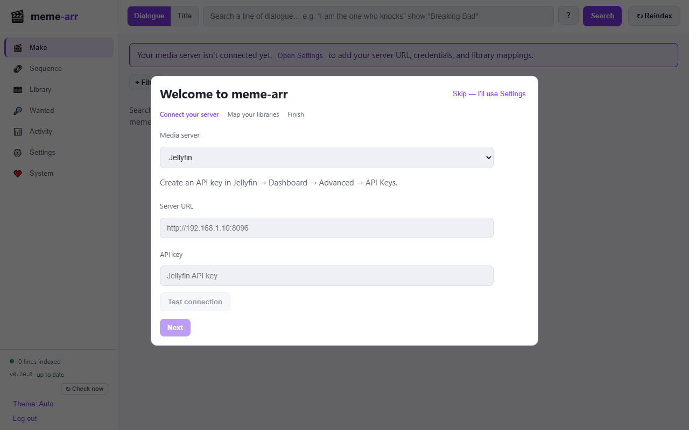
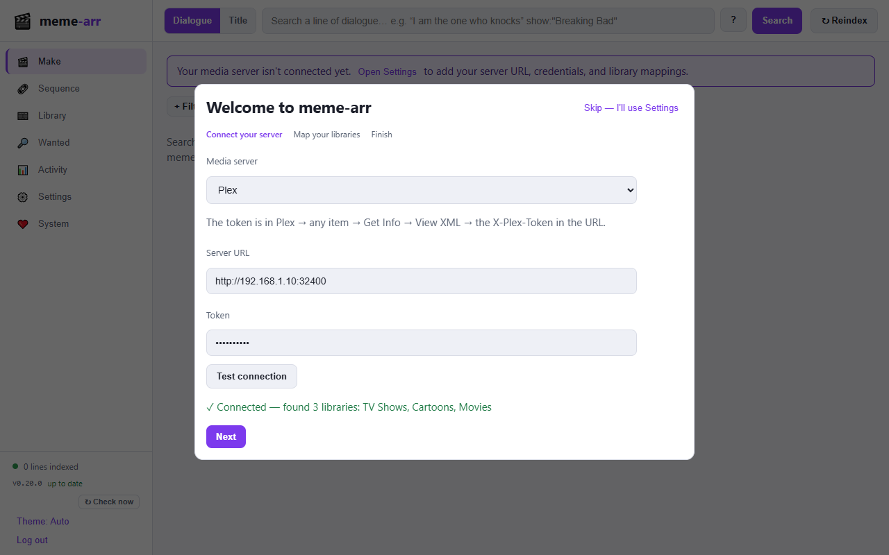
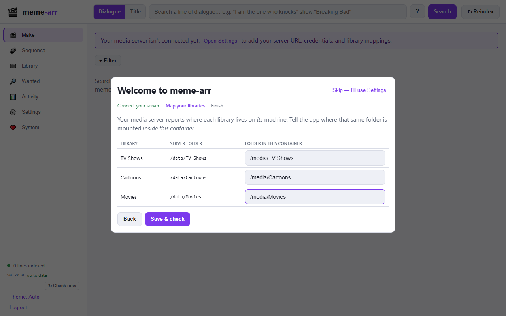
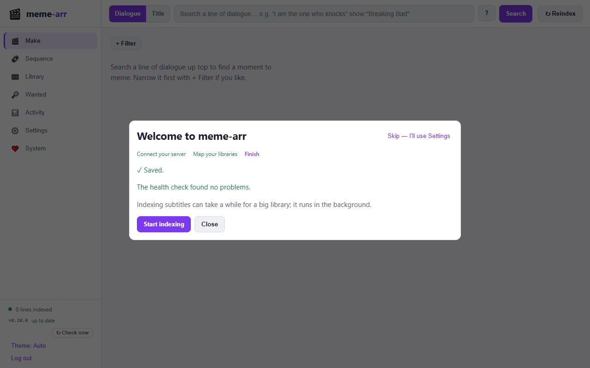
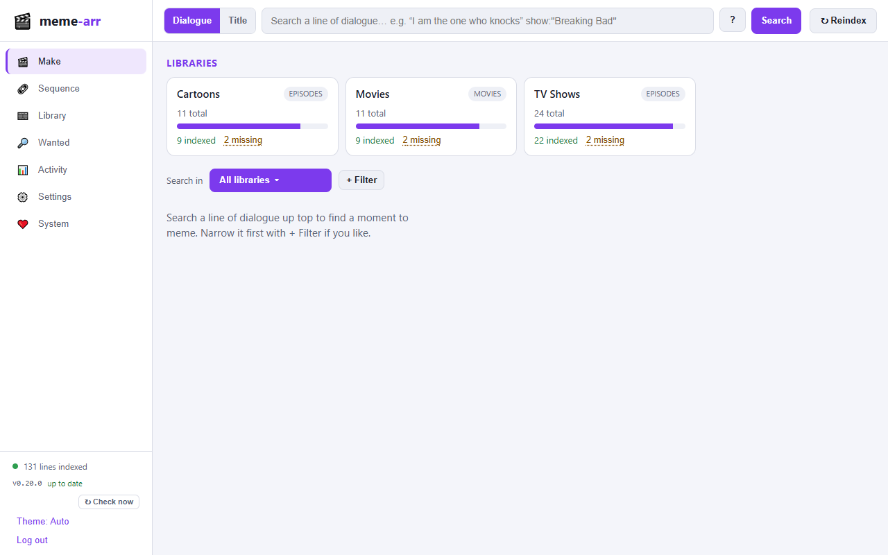

# Getting started

From nothing to your first meme in about ten minutes. You'll install meme-arr with
Docker, connect it to Plex or Jellyfin, and let it index your subtitles. The pictures
use a made-up library (so none of it is yours), and the paths and addresses in them
are examples: use your own.

**In short:** start the container with your media folder mounted → open it in a
browser and set a password → tell it where your Plex or Jellyfin server is and where
each library's folder is mounted → search a line of dialogue.

## Before you start

You need:

- **A computer that runs Docker**, with a 64-bit Intel/AMD CPU (the image is
  `linux/amd64`). A NAS (Synology, QNAP, Unraid…), a home server or any Linux box
  works. Docker Desktop on Windows or macOS is fine for trying it out.
- **Plex Media Server or Jellyfin**, already set up with your libraries. Online
  subtitle search (optional) needs Plex 1.13.8.5395 or newer.
- **Your media as files the container can read.** meme-arr reads the same video files
  your server does, over the same folders or shares, and it only needs **read** access.
  (It does not stream video through Plex or Jellyfin.)
- **Subtitles.** Dialogue search works on text subtitles: `.srt`/`.ass`/`.vtt` files
  next to the video, or text tracks inside it. Picture-based subtitles (Blu-ray PGS,
  DVD) can't be searched, and an item with no subtitles appears on the **Wanted** tab
  so you can fetch some.

## 1. Install

Pick one. All of them end with the app listening on port **8089** of your Docker host.

### Docker Compose

Save this as `docker-compose.yml` in a folder of your choice, then change the media
path on the last volume line to where your media lives **on the Docker host**:

```yaml
services:
  meme-arr:
    image: ghcr.io/memearr/meme-arr:latest
    container_name: meme-arr
    restart: unless-stopped
    ports:
      - "8089:8080"            # open http://<host-ip>:8089
    environment:
      PUID: "1000"             # the user the app runs as (see "Permissions" below)
      PGID: "1000"
    volumes:
      - ./data:/data           # settings and the subtitle index: keep this
      - ./output:/output       # finished memes are saved here
      - /volume1/video:/media:ro   # <- your media, read-only
```

```bash
docker compose up -d
```

How to read a volume line: `host folder : folder inside the container : options`. The
`:ro` means read-only, so the app can never change your media. Mount the **top** folder
that holds all your libraries, for example `/volume1/video` containing `TV Shows` and
`Movies`; you'll tell the app which sub-folder is which in step 3.

### Synology (Container Manager) or Portainer

Create a **Project** (Container Manager) or a **Stack** (Portainer) and paste the same
compose file. On a Synology the host paths look like `/volume1/docker/meme-arr/data`
and `/volume1/video`. Everything else is configured later, in the app.

### `docker run`

```bash
docker run -d --name meme-arr --restart unless-stopped -p 8089:8080 \
  -e PUID=1000 -e PGID=1000 \
  -v "$PWD/data:/data" -v "$PWD/output:/output" -v /volume1/video:/media:ro \
  ghcr.io/memearr/meme-arr:latest
```

### Permissions

The app runs as the user `PUID`:`PGID` (default 1000:1000). That user must be able to
**read your media**. If your media is readable by everyone, nothing more is needed.
Otherwise set `PUID`/`PGID` to the owner of the media (find it with `id <user>` on the
host). `/data` and `/output` are fixed up automatically on start.

> **Media on a network share (SMB/CIFS, NFS)?** Mount it on the Docker host first and
> bind-mount that folder as above; that is the most reliable way. If you'd rather have
> Docker mount the share itself, see [Media on a network share](#media-on-a-network-share).

## 2. Open it and set a password

Browse to `http://<your-host-ip>:8089`. The very first time, you create the one admin
password (at least 8 characters). There is no sign-up; this is the only account.



> It is meant for your own network. If you want to reach it from outside, put it behind
> a reverse proxy and read [Security](SECURITY.md),
> [Deployment](DEPLOYMENT.md#behind-a-reverse-proxy) and
> [Authentication](AUTHENTICATION.md) first.

## 3. Connect your media server

A short **setup wizard** opens with three steps: connect, map your libraries, finish.

### Connect

Choose **Plex** or **Jellyfin**, enter the server's address and its token or API key,
and press **Test connection**.



- **Address.** Use the server's address on your network, with the port:
  `http://192.168.1.10:32400` for Plex, `http://192.168.1.10:8096` for Jellyfin. Don't
  use `localhost` or `127.0.0.1`, even if Plex runs on the same machine: inside the
  container that means the container itself. Use the machine's LAN IP, or the other
  container's name if both are on the same Docker network.
- **Plex token.** In Plex Web, open any movie or episode, click **⋯ → Get Info →
  View XML**, and copy the value after `X-Plex-Token=` in the address bar. (Plex
  explains it too:
  [finding an authentication token](https://support.plex.tv/articles/204059436-finding-an-authentication-token-x-plex-token/).)
  Treat it like a password.
- **Jellyfin API key.** In Jellyfin open **Dashboard → Advanced → API Keys**, add a key
  (any name, for example "meme-arr") and copy it.



When it works you see "Connected" and the libraries it found. Movie and TV libraries
are used; others (music, photos) are ignored.



### Map your libraries

Your server reports where each library lives **on its own machine**; the app needs to
know where **the same folder** is mounted **inside its container**. That is the one
step people stumble on, so here is how to read the table:



| Column | Meaning |
|---|---|
| **Server folder** | the path Plex or Jellyfin reports for the library (`/data/TV Shows`). You can't edit it; it comes from the server |
| **Folder in this container** | where that same folder is inside meme-arr (`/media/TV Shows`): the right-hand side of your `-v` line, plus the sub-folder |

Worked example. Plex runs in its own container with `/volume1/video` mounted at
`/data`, so it reports `/data/TV Shows`. You gave meme-arr the same host folder as
`/volume1/video:/media:ro`, so the same files are at `/media/TV Shows`. The mapping is
`/data/TV Shows` → `/media/TV Shows`.

More cases:

| Where the server runs | It reports | Map it to |
|---|---|---|
| In Docker with `/volume1/video:/data` | `/data/TV Shows` | `/media/TV Shows` (you mounted `/volume1/video:/media:ro`) |
| Directly on the NAS or a Linux box | `/volume1/video/TV Shows` | `/media/TV Shows` (same mount as above) |
| On Windows, drives `D:` and `E:` | `D:\TV Shows\Show\S01E01.mkv` | `/media/d/TV Shows` (mount drive `D:` at `/media/d`, `E:` at `/media/e`) |

The app is not case-sensitive about Windows drive letters and understands `\`. If a
folder is left blank it isn't indexed; you can add it later in **Settings**. A good
check: the path you type must be a folder you can see when you open a shell in the
container (`docker exec -it meme-arr ls "/media/TV Shows"`).

Press **Save & check**.

### Finish

The wizard runs a health check and tells you if something needs attention (for
example, a folder that doesn't exist in the container, with how to fix it).



Press **Start indexing**. The app now reads every video's subtitles (an embedded text
track or a file beside it) and indexes every line. It runs in the background, so you can
use the app straight away; **Make** shows "Indexing n/total" while it works, and the
**Activity** tab has the detail. A big library takes a while the first time; after that
only new or changed files are read.

## 4. Make your first meme

When the first items are indexed, type a line you remember into the search box and
press **Search**. The cards under the box show each library's progress.



Then click a result: the editor opens on that moment. Adjust the start and end,
choose captions and a format, and press **Export**. When it finishes you get a
download link and a preview, and the file is also saved in your `output` folder.


The [Using meme-arr](USING.md) page walks through everything else: narrowing a search
(`show:"Orbital Diner" -ep:docking`), searching only some libraries, sequences of
several clips, and finding missing subtitles.

## If something doesn't look right

| You see | Most likely | What to do |
|---|---|---|
| "Couldn't connect" on Test connection | wrong address, or `localhost` used | use the server's LAN IP and port; check the container can reach it (`docker exec meme-arr wget -qO- http://<ip>:32400/identity`) |
| Connected, but the library list is empty | the token or API key has no access to libraries | make a new one as an admin |
| The health check says a folder doesn't exist | the mapping's right-hand side isn't a folder inside the container | compare with `docker exec -it meme-arr ls /media`; fix the mount or the mapping in **Settings** |
| Search finds nothing | indexing hasn't reached it yet, or the items have no text subtitles | look at **Activity** and the **Wanted** tab |
| Items are listed as "unreachable" | the mapping doesn't cover their folder | fix the mapping; the **System** tab says which |
| "Permission denied" reading media | `PUID`/`PGID` can't read your files | set them to your media's owner |

More in [Troubleshooting](TROUBLESHOOTING.md), [Operations](OPERATIONS.md) and the
[Health checks](HEALTH.md) page (each health message links there).

## What next

- **Keep it up to date.** The image is published to GitHub's container registry; pull a
  newer `:latest` (or a version tag such as `:v0.21.0`) and recreate the container. Your
  settings and index live in `./data`, so they survive. Back up `./data`, or use
  **System → Backups** (settings only).
- **Fill in missing subtitles.** The **Wanted** tab lists items with no searchable
  subtitles and can search your server's own subtitle sources for them.
- **Secure it.** Add login with [Plex or Authentik](AUTHENTICATION.md), and run it
  behind HTTPS if it's reachable from the internet.
- **Look around.** The [Using meme-arr](USING.md) tour covers every tab.

## Media on a network share

If your media is on another machine and you want Docker itself to mount it, here is
an example for a Windows (SMB/CIFS) share. Mounting on the host and bind-mounting (as in
step 1) is simpler and more reliable; use this only if you need to.

```yaml
services:
  meme-arr:
    image: ghcr.io/memearr/meme-arr:latest
    ports: ["8089:8080"]
    volumes:
      - ./data:/data
      - ./output:/output
      - media:/media:ro
volumes:
  media:
    driver: local
    driver_opts:
      type: cifs
      device: "//NAS/Video"            # //host/share
      o: "username=USER,password=PASS,vers=3.0,ro,uid=0,gid=0,file_mode=0444,dir_mode=0555"
```

Things that commonly go wrong:

- **A `$` in the device** (Windows admin shares such as `D$`) must be written `$$` in a
  compose file.
- **Editing the volume has no effect.** Docker caches a named volume's options when it
  is created: `docker volume rm <project>_media`, then start again.
- **`mount … no such file or directory`.** The share doesn't exist. Windows only creates
  the `D$` admin shares for fixed disks; share USB/removable drives by name.
- **Snap-packaged Docker** often refuses CIFS volumes. Mount on the host instead
  (`sudo apt install cifs-utils`, an `/etc/fstab` line with
  `cifs credentials=/etc/win-smb.cred,ro,vers=3.0,nofail`, then `sudo mount -a` and
  `sudo snap connect docker:removable-media`) and bind-mount the folder.
- **`file_mode=0444,dir_mode=0555`** make the files world-readable, so the app (which
  doesn't run as root) can read them; keep them if you change the other options.

A ready-made compose file with five shares is in
[`examples/smb/`](https://github.com/memearr/meme-arr/tree/main/examples/smb).
