# Using meme-arr

A tour of the app, in the order you'll use it (new here? Start with
[Getting started](GETTING-STARTED.md), which covers installing and connecting your
server). Every picture here was taken against
a **made-up library** (shows like *The Lantern Cove* and *Orbital Diner*, with
invented dialogue) served by a pretend Plex server, so nothing in them comes from a
real collection. You can build the same library yourself in a minute; see
[Try it with the mock library](#try-it-with-the-mock-library).

## Find a moment

Type a line you remember into the search box and press **Search**. *Dialogue* looks
inside the subtitles that were indexed; *Title* looks at show, episode and movie
names. Each result is one line of dialogue, with the show, episode and the moment it
is said.

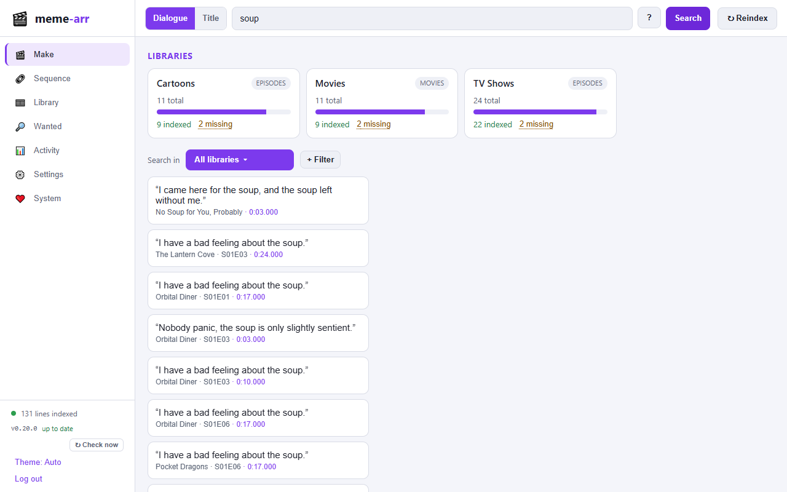

- The cards at the top summarise each library: how many items are indexed and how
  many are still **missing** subtitles.
- Results come 50 at a time. The list says "Showing the first 50 matches" and a
  **Show more** button loads the next page; a finished list says "95 matches".
- When there is more than one library, **Search in** limits the search to any
  subset of them. Tick as many as you like; nothing ticked means all of them.

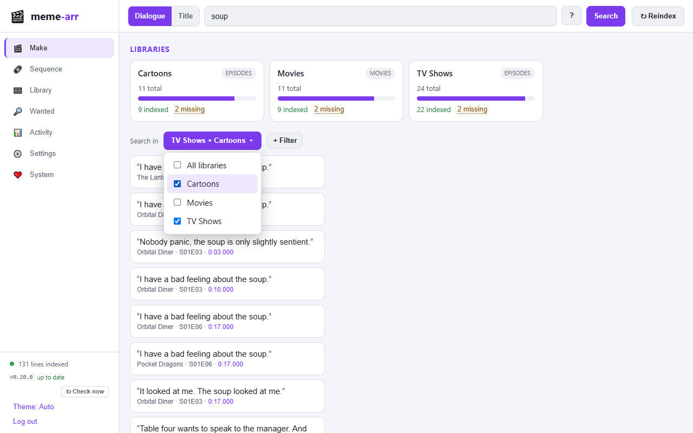

## Narrow it first, then search inside it

Under the search box is a filter bar. **+ Filter** adds a filter (a show, an episode
title, a movie title, a season number, only movies, only episodes, or the opposite of
any of them with *Exclude these instead*), and **Search in** picks libraries. Each filter
becomes a chip that **stays** while you search, so you can narrow to a subset first and
then search the dialogue *inside* it. Remove a chip with its **×**.

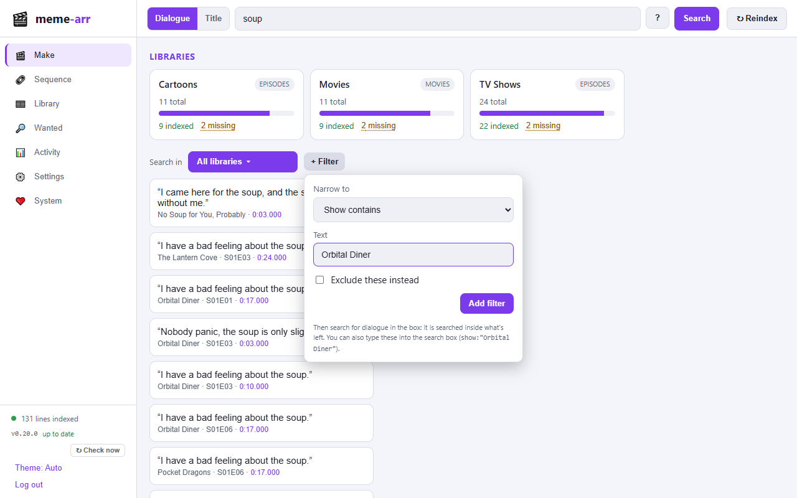

With a filter set and nothing typed, the page lists the items the filter leaves; type some
dialogue and it searches only those. Change the text as often as you like; the filter stays
until you remove it (it also applies in Title mode, and survives a visit to another tab).

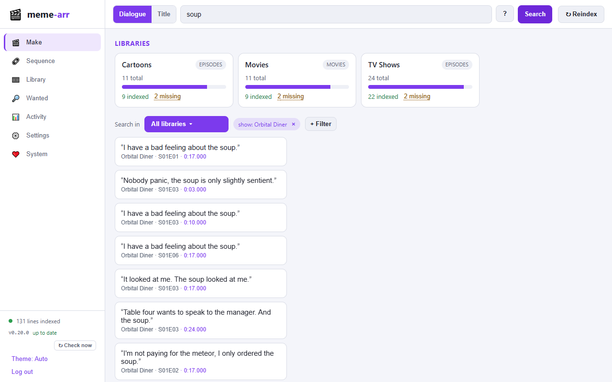

In the **Library** tab, a show's episode list has **Search dialogue in this show**: it
applies that show as a filter and puts the cursor in the search box.

## Narrow it down like a web search

You can also put operators in the search box itself; a filter chip is just a friendlier way
to add the same thing, and the two work together. Whatever is left over is the text that gets
searched, so you can still search the dialogue (or the title) at the same time.

| Type | Meaning |
|---|---|
| `show:"Orbital Diner"` | only that show (its name just has to contain the text) |
| `-show:"Lantern Cove"` | leave a show out (movies, which have no show, are kept) |
| `ep:docking` | episodes whose title contains "docking" |
| `movie:lighthouse` | movies whose title contains "lighthouse" |
| `movie:` or `ep:` on its own | only movies, or only episodes |
| `library:Cartoons`, `season:2` | one library, one season number |
| `-walter`, `-"say my name"` | leave out dialogue lines (or titles) containing a word or phrase |
| a leading `-` on any operator | turn it around, e.g. `-ep:docking` |

For example, `soup show:"Orbital Diner" -ep:docking` finds the soup lines in
*Orbital Diner*, except from the "Docking Fees" episode. The page reads back what it
understood ("Using show: Orbital Diner · not episode: docking"):

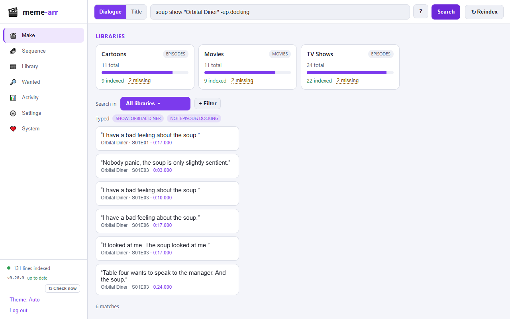

The **?** next to the search box lists them all:

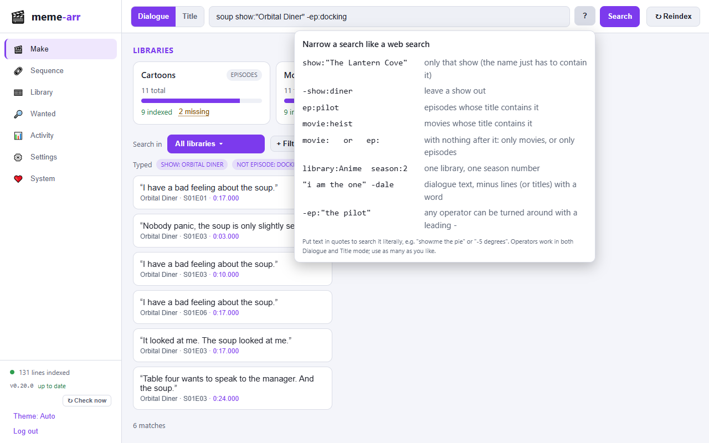

In **Title** mode the same operators narrow by show and episode title, which is
where they help most: `show:"Lantern Cove" season:2 -ep:gull` lists the second
season's episodes except the gull one.

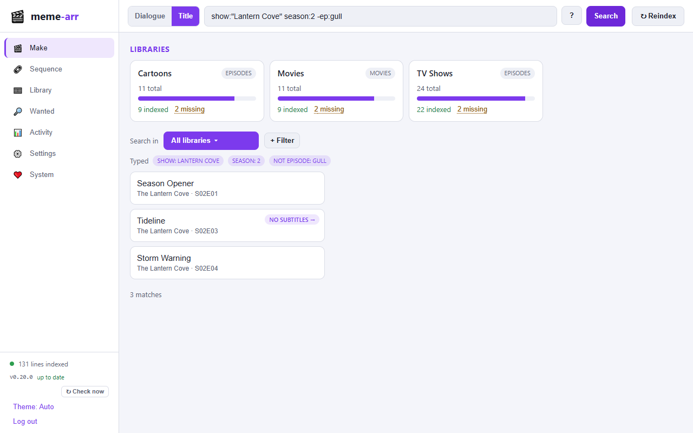

A few things worth knowing:

- Put text in quotes to search it literally: `"show:me the money"` and
  `"-5 degrees"` are words, not operators. Anything with a colon that isn't an
  operator (`note: hello`, `12:30`) is ordinary text too.
- With operators but **no dialogue text** (just `show:"Orbital Diner"`), Dialogue
  mode lists the matching *items* instead of nothing, with a note saying so.
- Excluding a word in Dialogue mode removes only the *lines* that contain it, and
  needs some dialogue text to search for. There is no OR and no grouping.

## Make the clip

Click a result. The editor opens with a preview of that moment, already trimmed to the
line with a little padding. Trim it, choose captions (none, the real subtitles, or your
own top and bottom text), pick a format (WebP, MP4, WebM or GIF), size and quality, and
export. Tick **Include audio** to keep the clip's sound (MP4
and WebM only; GIF and WebP can't carry audio). Finished files also land in your output folder.

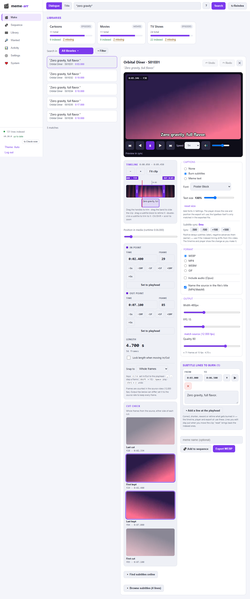

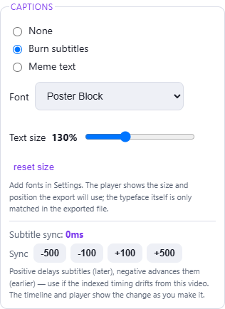

- **Trim without waiting.** The timeline shows a filmstrip of the part of the film around
  the clip. Drag the **In** and **Out** handles (or focus one and use the arrow keys),
  drag the highlighted band to slide the whole clip, or click the ruler to move the
  playhead. Ctrl or Shift plus scroll zooms; **Fit clip** frames the clip again. Moving
  the points inside the footage already prepared needs no new render, so the preview
  stays in step as you drag; it only re-renders when you move beyond it.
- **Exact times and frames.** Under the timeline, type an **In** or **Out** as a time
  (`2.4`, `0:02.400`, `00:00:02.400`) or a frame number (`f58`); it takes effect as
  soon as it reads. Nudge buttons step ±1 frame, ±10 frames or ±1 second, and **Set to
  playhead** takes the current frame. **Lock length** moves In and Out together.
  **Snap to** whole frames (the default), subtitle edges, or nothing. Frames are counted
  in the source video, at its own frame rate. The **Cut check** shows the last frame
  cut and the first frame kept at each end.
- **Keys.** `I` and `O` set In and Out to the playhead, `,` and `.` step a frame (hold
  Shift for ten), Space plays, and Ctrl+Z / Ctrl+Shift+Z undo and redo a trim.
- **Frames and output fps.** Frame numbers refer to the source video. The export's
  **FPS** slider re-samples the clip, so to keep every frame you picked, use
  **match source** next to it (frame rates above 30 are capped at 30).
- **Captions and sound in the player.** Subtitles and meme text are drawn over the video at
  the size and position the export will use, and follow the **Text size** slider as you move
  it (the typeface itself is applied in the exported file). The speaker button and volume
  slider next to the transport controls turn the clip's sound on and off and set its level;
  they only affect the player, and are remembered.
- **Burn subtitles** puts the indexed line on the clip. Each line is editable: fix a
  typo, shorten it, retime it (type a start and end, or drag its block on the timeline),
  split it at the playhead, add a line, or drop it. **Subtitle sync** shifts the timing if this release
  of the video drifts from the subtitle file.
- **Font and text size.** With burned subtitles or meme text selected, **Font** picks the
  typeface and **Text size** scales the text (50% to 300%; 100% is normal). Your choice is
  remembered for next time, and each clip in a sequence keeps its own. Add fonts under
  [Settings](#settings).
- **Exports are clean.** Nothing from the original file is copied into a meme: not its
  release name or other tags, comments, chapters, creation dates, track names or
  subtitle tracks. The one thing a file may carry is the movie or show/episode it came
  from, as its `title` (MP4 and WebM; untick **Name the source in the file's title** to
  leave even that out).
- **Find subtitles online** (above the trim controls) searches your media server's
  own subtitle sources, if the item has no subtitles or the wrong ones; see
  [Find missing subtitles](#find-missing-subtitles).

### Sequences

**Add to sequence** queues a clip. The **Sequence** tab joins several clips, from
any shows or movies, into one back-to-back GIF, WebP, MP4 or WebM (up to 20 sections and
3 minutes), and edits them as a set:

- **Play the whole sequence.** The player at the top plays every section one after
  another, with the captions burned in the way the export will draw them (each section
  is drawn small, and the next one is fetched while the current one plays). The slider
  moves anywhere in the sequence; Space plays and pauses.
- **The strip.** Below the player every section is a block as wide as it is long, in play
  order, with its picture, number and length, and a bar showing how much of the 3 minutes
  is used. Click a block to pick it; **drag blocks to reorder** them (or use
  **◀ Earlier / Later ▶**); **Duplicate** and **Remove** act on the picked one.
- **One section.** The picked section gets exact **In/Out** (typed times or frame numbers,
  nudges), its caption mode (none, burned subtitles, meme text), font and size, and the
  subtitle sync. **✎ Detailed edit** opens it in the full editor, with the player, timeline
  and every subtitle line; **Save to sequence** puts it back in its place and
  **Save and edit next clip** carries on down the list.
- **All sections.** One click burns subtitles into every section or removes all captions,
  sets one font and size for every caption (meme words are left alone), moves every start
  or end by a quarter or half a second, shortens every section to a longest length, or
  reverses the order.
- **Undo and redo** step back through every change made here (typing a time or dragging a
  slider counts as one step).

The format, width, frame rate and quality are set once for the whole sequence, below the
editor, along with the export button.

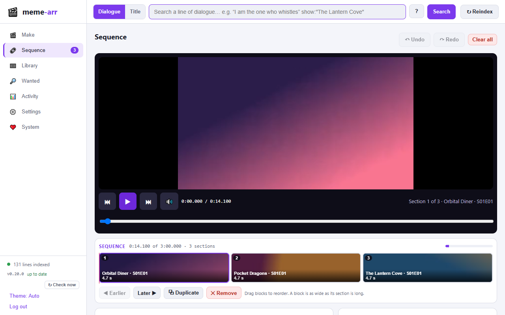

## Browse the library

The **Library** tab lists every movie and show, with how many episodes are indexed and
how many are missing subtitles. Click a show to open its episodes.

Two filters narrow the list, and they combine with the title box:

- **Libraries** (shown when you have more than one): tick any subset, or leave it on
  *All libraries*.
- **All / Missing subtitles / Fully indexed**: *Missing subtitles* lists the movies and
  shows that still have at least one item without subtitles; *Fully indexed* lists the
  ones with nothing missing.

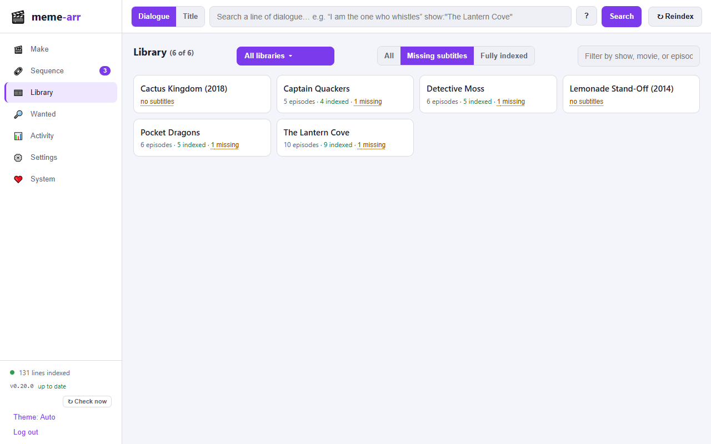

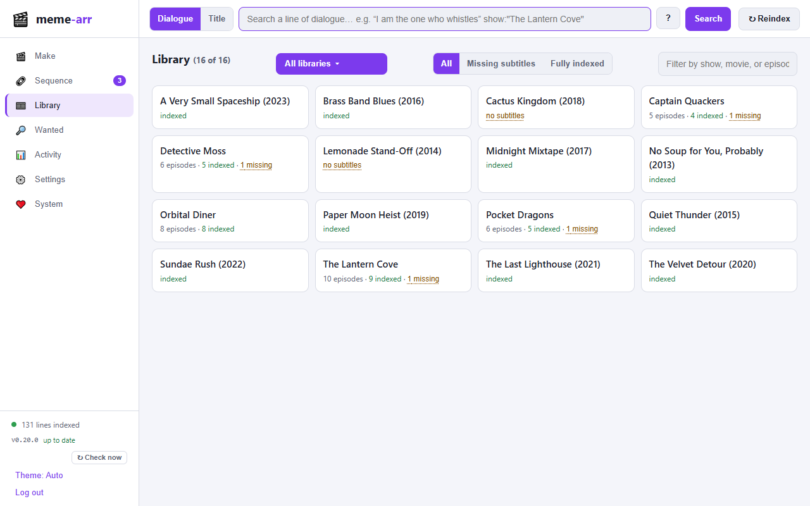

## Find missing subtitles

Wherever the app says something has **no subtitles** or **N missing**, that notation is
a link: click it and you land on **Wanted** with exactly that pulled up.

| You click | You land on |
|---|---|
| **N missing** on a library card (Make) | Wanted, with just that library selected |
| **Find subtitles** next to an item in a library's *Missing subtitles* list (Make) | Wanted, with that item's subtitle search open and ready |
| **N missing** on a show card (Library tab) | Wanted, filtered to that show's missing episodes (if only one is missing, its search opens) |
| **no subtitles** on a movie card (Library tab) | Wanted, with that movie's search open |
| **no subs →** next to an episode in a show's episode list | Wanted, with that episode's search open |
| **no subtitles →** on a result in Title search (Make) | Wanted, with that item's search open |

(The cards themselves still open the item or the show, as before.) If an item isn't
on the Wanted list after all, because it has subtitles now or its file can't be
reached, Wanted says so instead of leaving you guessing.

Items with no searchable subtitles are listed under **Wanted**. The same multi-library
picker as the search narrows the list, and the box next to it filters by title.

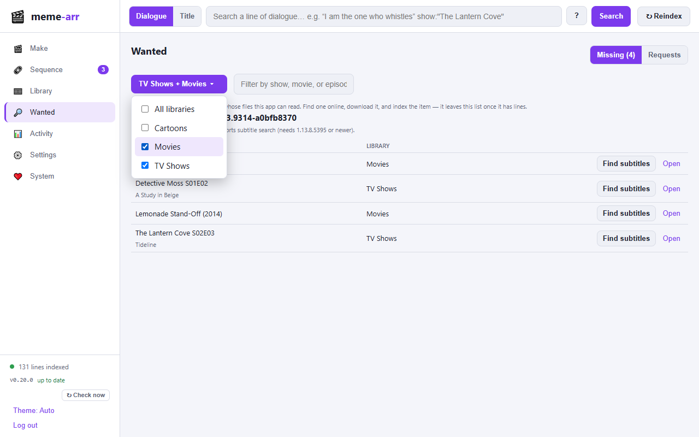

**Find subtitles** on a row searches the online sources your media server uses (Plex's
built-in search, or Jellyfin's subtitle providers). Each result shows the release
name, the source, the format and how well it matches.

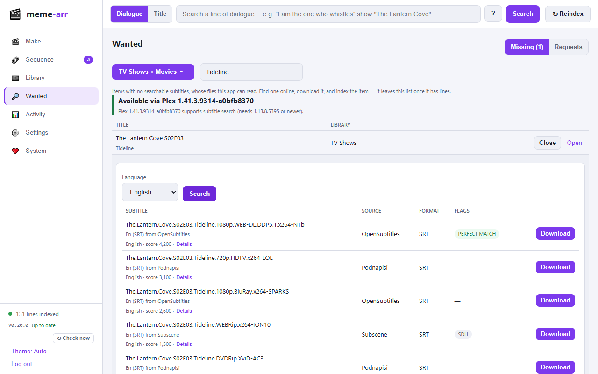

**Download** asks the server to fetch it. The server does that in the background, so
the download is tracked on the **Requests** tab until it becomes searchable. Plex
keeps a downloaded subtitle in its own database rather than as a file; **Re-index**
reads it through Plex and indexes it (and a scheduled task re-checks waiting requests
every hour, so you don't have to press it). If you'd also like the `.srt` file next
to the video, turn on *Also save it as a .srt file next to the video* in
**Settings**.

A request that stays **Waiting** has a **Diagnose** button. It compares what this app
can see (the video, the subtitle files beside it) with what the server says it has,
and says the likely cause in plain words:

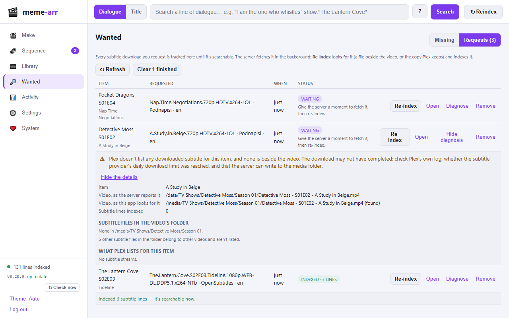

### With Bazarr

If you run [Bazarr](https://www.bazarr.media/), connect it under **Settings → Bazarr**
(its address, e.g. `http://bazarr:6767`, and its API key from *Bazarr → Settings →
General → Security*). Bazarr writes its subtitles next to your videos, and this app
reads those files with or without the connection; connecting it adds:

- **Search with Bazarr**, on every row of Wanted and in the editor. Bazarr searches
  its providers for the languages it is missing for that movie or episode. (The app
  matches the file to Bazarr's own entry by the end of its path, so the two can mount
  the media in different places. If two entries look alike it says so instead of
  guessing.)
- **Fix timing with Bazarr**, in the editor, for a subtitle file beside the video:
  Bazarr re-times it against the audio, then **Re-read subtitles** picks up the
  corrected file. This is for a subtitle that drifts; **Subtitle sync** in the
  editor still shifts one by hand for a single clip.
- **Apply to the subtitle file**, under **Subtitle sync** in the editor (only with Bazarr
  connected). The sync you set there normally only changes the clip you are making. This
  button asks Bazarr to shift the `.srt` beside the video by that amount, so the correction
  is permanent: search results open at the right moment, and other players get it too. The
  item is re-read afterwards and the sync box resets to 0. It changes the whole subtitle
  file, and only `.srt` files (not subtitles inside the video).
- **Instant refresh.** The settings panel shows an address to add in Bazarr under
  *Settings → Notifications* (an Apprise `json://` URL). When Bazarr writes a
  subtitle it calls it, and the library is scanned a few seconds later instead of at
  the next scheduled scan. The secret is part of the address; **New address** replaces it.
- **Language preference.** When a video has subtitles in several languages, the app
  indexes the one in Bazarr's first profile language. Without the connection it prefers
  English. A **forced** subtitle (foreign-language lines only) is only used when there
  is nothing else, and a plain subtitle is preferred over one for the hard of hearing.
- **Read-only media folders.** Bazarr saves from its own mount, so *Search with
  Bazarr* works where *Also save it as a .srt file* can't.

## Keep an eye on it

**System** shows health checks (each says how to fix a problem), what the media
server supports, index statistics and the scheduled tasks, with last and next run and
a *Run now* button for each. **Activity** is the log of what the app has been doing:
indexing, subtitle requests, errors.

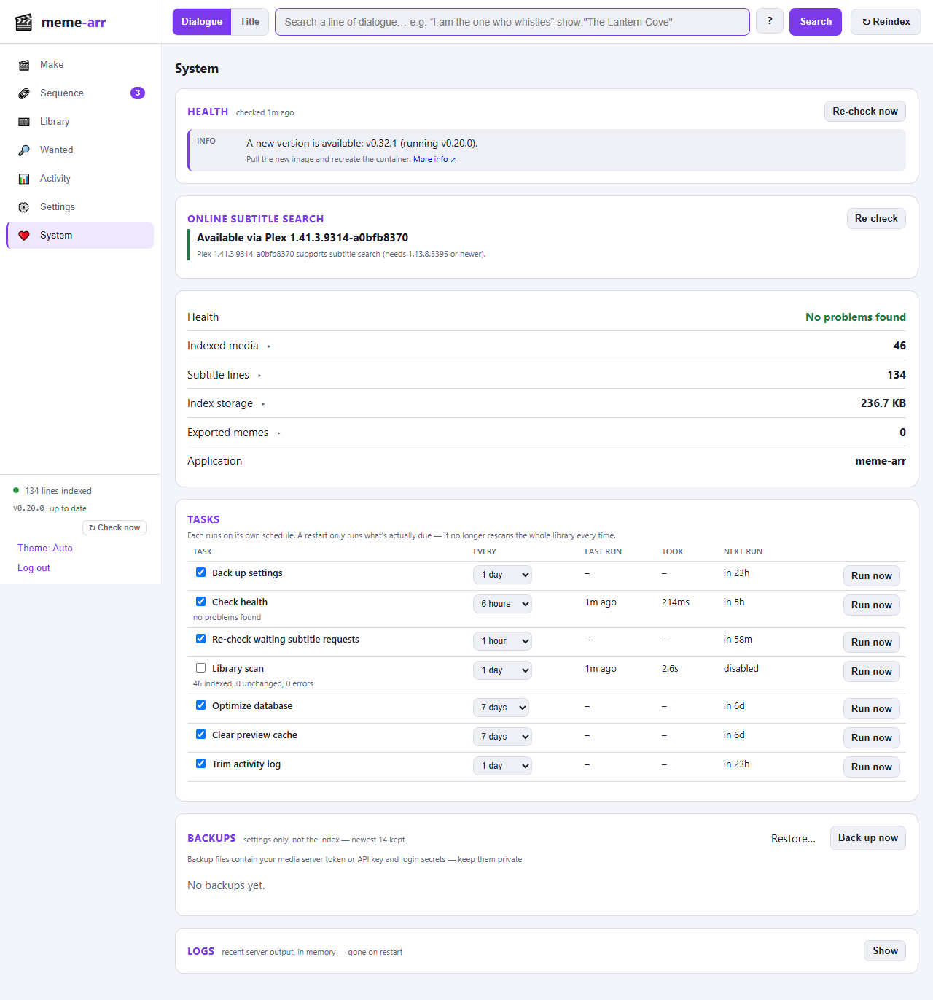

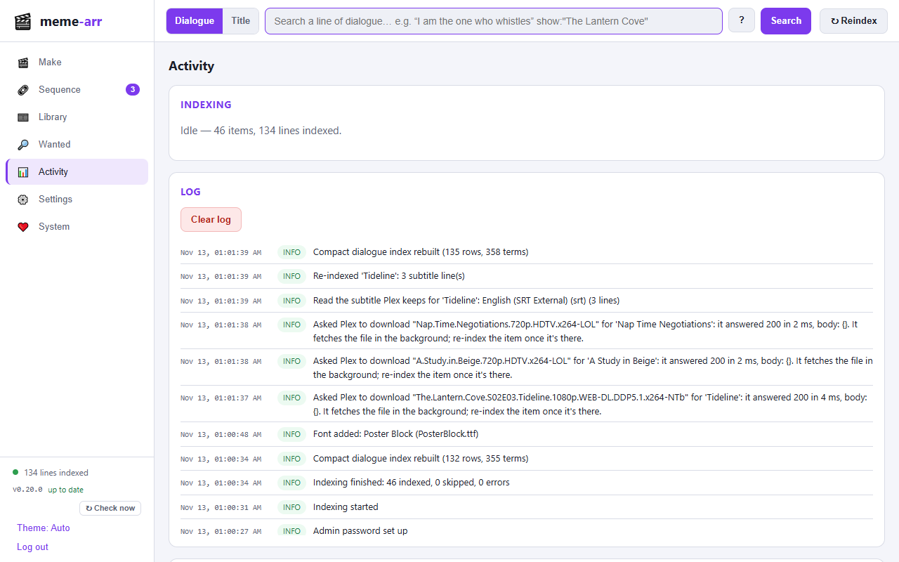

## Settings

**Settings** holds the media server connection, the **library path mappings** (which
folder the server reports, and where the same folder is mounted for this app), the
**caption fonts**, login options, the API key and trusted proxies.

**Caption fonts** lists the fonts captions can use. The ones that come with the app are
marked *built in*: DejaVu Sans (the default) and the open-source Anton, Bebas Neue, Bangers,
Comic Neue and Luckiest Guy. **Upload a font** adds your own TrueType or OpenType file (`.ttf` or
`.otf`, up to 16 MB, up to 50 fonts); it then appears in the editor's **Font** picker. Delete an uploaded font with its
**Delete** button. Only upload fonts you have the right to use.

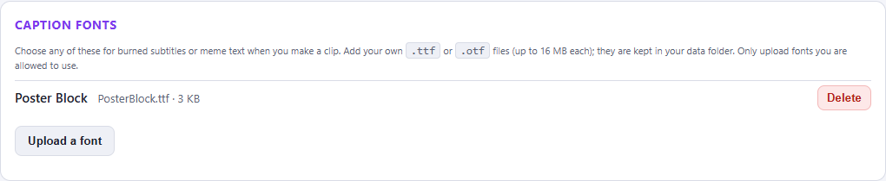

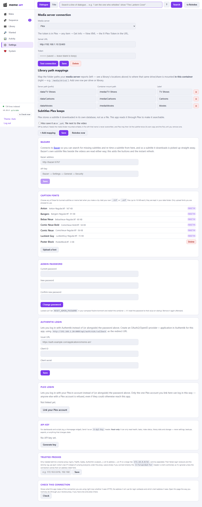

## Dark theme and phones

The theme follows your system (or switch it from the sidebar), and every tab works on
a phone.

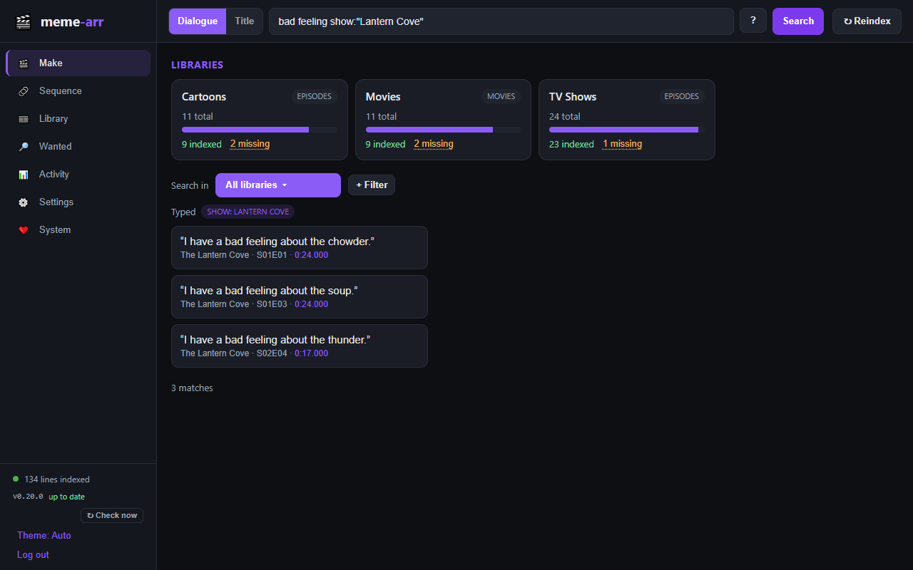

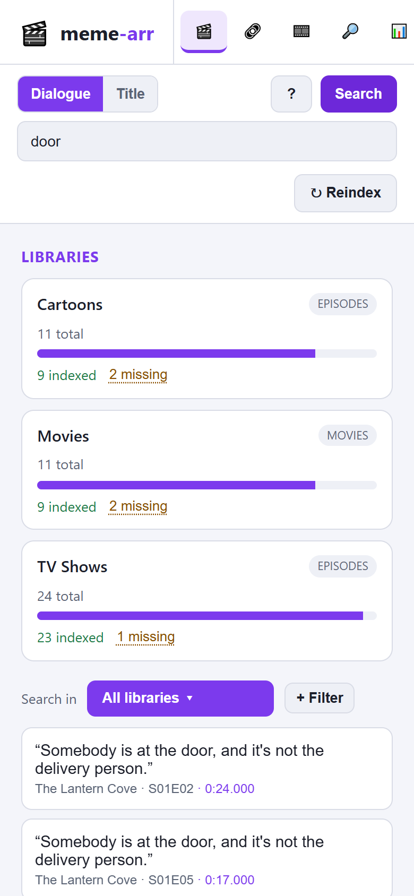

## Try it with the mock library

The pictures above come from a mock library in `dev/mock/`: 46 invented items
(about 3 MB of placeholder video plus subtitles) and a pretend Plex server. It is also
a handy way to try the app, or test a change, without a real library. See
[Development](DEVELOPMENT.md#mock-library-and-screenshots) for how to run it and how
the screenshots are regenerated.
